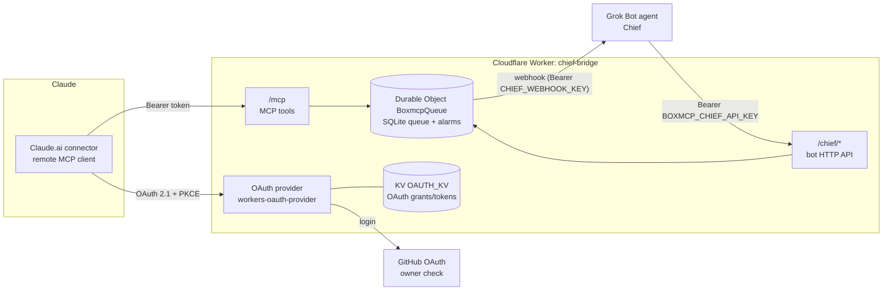

# Claude Bridge (chief-bridge)

A small **remote MCP server on Cloudflare Workers** that lets a Claude session and a Grok Bot agent ("Chief") talk to each other directly.

Claude gets a few MCP tools (`send_to_chief`, `wait_for_reply`, ...). When Claude sends a message, the bridge stores it in a Durable Object queue and fires a webhook that wakes your Grok Bot agent. The agent reads its inbox over a small authenticated HTTP API, posts a reply, and Claude picks the reply up with `wait_for_reply`.

> This is a plain remote MCP server (Streamable HTTP + OAuth). It is **not** a Claude Code "Channels" server.

## Architecture



## Message flow

1. Claude calls `send_to_chief(text)`. The worker stores it in the `BoxmcpQueue` Durable Object (a single SQLite-backed instance) and returns `{thread_id, id}`.
2. The Durable Object schedules a webhook with an alarm and `POST`s `{"source":"chief-bridge","pending":N}` to `CHIEF_WEBHOOK_URL` with `Authorization: Bearer <CHIEF_WEBHOOK_KEY>` (header name and scheme are configurable). The message text is **not** sent in the webhook.
3. The woken agent calls `GET /chief/inbox`, then `POST /chief/reply {thread_id, text}` and `POST /chief/ack {ids}`.
4. Meanwhile Claude loops on `wait_for_reply(thread_id, after_id)`. Each call long-polls the Durable Object for up to 55 s; a reply wakes it immediately. The server instructions tell Claude to keep looping for about 5 minutes and to call `read_chief_replies` before concluding there is no reply.

Webhook scheduling (in `src/queue.ts`):

- No debounce: the first message after a quiet period fires immediately.
- At least 5 s between webhook fires; messages arriving inside that window are coalesced into the next fire, not dropped.
- Hard cap of 60 fires per hour (retries included).
- Non-2xx or network error: retries after +1, +5, +15 minutes (25 s request timeout, redirects not followed).
- If new messages arrive while a fire is in flight, a follow-up webhook is scheduled after a success; if retries are exhausted, the chain restarts once for messages that arrived during it.

## MCP tools (Claude side)

| Tool | What it does |
|---|---|
| `send_to_chief` | Send a message (max 8000 chars). Omit `thread_id` to start a new thread. Rate-limited to 30/hour. |
| `wait_for_reply` | Long-poll for a reply in `thread_id` with id > `after_id`. `timeout_s` is clamped to 1..55 (default 50). |
| `read_chief_replies` | Read replies with id > `since`, optionally for one thread (max 20). |
| `get_thread` | All retained messages in a thread, both directions. |
| `chief_status` | Pending count, last activity, whether a webhook is configured/scheduled. |

Replies are returned wrapped as `<chief_message untrusted="true" ...>` with `<`/`>` escaped and control/bidi characters stripped, and the server instructions tell Claude to treat that content as data, not instructions.

## Bot API (agent side)

All `/chief/*` endpoints require `Authorization: Bearer <BOXMCP_CHIEF_API_KEY>` (or `_NEXT`, for rotation; compared in constant time). Rate-limited to 60/min.

| Method & path | Body | Result |
|---|---|---|
| `GET /chief/health` | – | `{ok, pending, webhook_configured, webhook_url_valid}` |
| `GET /chief/inbox?limit=1..100` | – | Unacked Claude→Chief messages (`untrusted: true`) |
| `POST /chief/reply` | `{thread_id, text}` | Reply in an existing thread; wakes waiting `wait_for_reply` calls |
| `POST /chief/ack` | `{ids: [..]}` | Mark inbox messages handled (1..200 ids) |
| `POST /chief/send` | `{text}` | Start a new Chief→Claude thread |

Request bodies are capped at 64 KB.

## Setup

Requirements: a Cloudflare account (Workers + Durable Objects + KV), Node.js 22+, a GitHub account, and an agent that can receive an HTTPS webhook and make HTTP calls (built for a Grok Bot routine, but any agent works).

```bash
git clone https://github.com/asasds145/claude-bridge.git
cd claude-bridge
npm ci
npm test            # vitest, runs in workerd via @cloudflare/vitest-plugin
npx tsc --noEmit
```

1. **KV namespace**
   ```bash
   npx wrangler kv namespace create OAUTH_KV
   ```
   Put the returned id into `wrangler.jsonc` (`<YOUR_KV_NAMESPACE_ID>`).

2. **GitHub OAuth app** (GitHub → Settings → Developer settings → OAuth Apps):
   - Homepage URL: `https://chief-bridge.<your-subdomain>.workers.dev`
   - Authorization callback URL: `https://chief-bridge.<your-subdomain>.workers.dev/callback`
   - Put the Client ID into `GITHUB_CLIENT_ID` in `wrangler.jsonc`.

3. **Owner allowlist**: set `BOXMCP_OWNER_GITHUB_ID` to your numeric GitHub user id (`curl https://api.github.com/users/<login>` → `id`). Only this account can authorize.

4. **Public origin**: set `BOXMCP_PUBLIC_ORIGIN` to the worker's https origin (recommended; requests to other hosts get `421`).

5. **Deploy and set secrets**
   ```bash
   npx wrangler deploy
   npx wrangler secret put GITHUB_CLIENT_SECRET
   npx wrangler secret put BOXMCP_CHIEF_API_KEY      # e.g. openssl rand -hex 32
   npx wrangler secret put CHIEF_WEBHOOK_URL         # your agent's webhook (https)
   npx wrangler secret put CHIEF_WEBHOOK_KEY         # bearer token the webhook expects
   ```
   Until `GITHUB_CLIENT_SECRET` is set (and the owner id is non-zero), `/authorize` returns 503. Without `CHIEF_WEBHOOK_URL`, messages queue but nothing is woken.

6. **Add the connector in Claude**: Claude.ai → Settings → Connectors → Add custom connector → URL `https://chief-bridge.<your-subdomain>.workers.dev/mcp`. Approve on the consent page, log in with GitHub.

7. **Wire up the agent**: give your agent (e.g. a Grok Bot routine triggered by the webhook) the API key and tell it to read `/chief/inbox`, reply via `/chief/reply`, then `/chief/ack`.

8. **Smoke test** (read-only):
   ```bash
   printf 'Authorization: Bearer %s\n' "$KEY" > chief.hdr   # gitignored
   BRIDGE_URL=https://chief-bridge.<your-subdomain>.workers.dev CHIEF_HEADER_FILE=./chief.hdr npm run verify
   ```

For local development, copy `.dev.vars.example` to `.dev.vars` and run `npx wrangler dev`.

## Configuration

| Name | Kind | Example / placeholder | Purpose |
|---|---|---|---|
| `OAUTH_KV` | KV binding | `<YOUR_KV_NAMESPACE_ID>` | OAuth clients, grants, tokens |
| `QUEUE` | Durable Object | `BoxmcpQueue` | Message queue, webhook scheduler, rate limits |
| `BOXMCP_OWNER_GITHUB_ID` | var | `12345678` | The only GitHub user id allowed to authorize |
| `GITHUB_CLIENT_ID` | var | `<your-github-oauth-client-id>` | GitHub OAuth app |
| `BOXMCP_PUBLIC_ORIGIN` | var | `https://chief-bridge.<sub>.workers.dev` | Canonical origin (OAuth resource metadata) |
| `CHIEF_WEBHOOK_AUTH_HEADER` | var | `Authorization` | Header used for the webhook key |
| `CHIEF_WEBHOOK_AUTH_SCHEME` | var | `Bearer` | Scheme prefix (empty = raw key) |
| `GITHUB_CLIENT_SECRET` | secret | – | GitHub OAuth app secret |
| `BOXMCP_CHIEF_API_KEY` | secret | – | Key for `/chief/*` |
| `BOXMCP_CHIEF_API_KEY_NEXT` | secret (optional) | – | Second key for rotation |
| `CHIEF_WEBHOOK_URL` | secret | `https://<agent-webhook-host>/...` | Where to send the wake-up webhook (must be https) |
| `CHIEF_WEBHOOK_KEY` | secret | – | Token sent with the webhook |

## Security notes

- **Single-owner OAuth.** The worker is its own OAuth 2.1 authorization server (`@cloudflare/workers-oauth-provider`) and uses GitHub only to prove identity: it requests no GitHub scopes, checks the numeric user id against `BOXMCP_OWNER_GITHUB_ID`, and discards the GitHub token immediately.
- **PKCE S256 required**, explicit consent page showing where the token will go, and `redirect_uri` pinned to Claude.ai's callback (`https://claude.ai/api/mcp/auth_callback`). Error redirects only go to that URI.
- Access tokens live 1 hour. `/oauth/register` is limited to 5/hour per IP; `/mcp` to 20/min per token.
- **Bot endpoints** need a separate bearer API key (constant-time compare, rotation via `_NEXT`).
- **Webhook** carries only a pending count, authenticated with its own bearer key; https-only, no redirects followed.
- Everything coming from the other side is wrapped and marked untrusted on both ends (prompt-injection hygiene).
- **No secrets in the repo.** All secrets are Worker secrets; `.dev.vars`, `.env*`, and header files are gitignored. Logs record only event names, paths, and status codes (no bodies, headers, tokens, or query strings).
- Retention: messages are kept 30 days, at most 200 per thread and 5000 total.

## Limitations

- Single user, single queue (one Durable Object instance named `main`).
- The OAuth `redirect_uri` is hard-coded to Claude.ai's connector callback, so other MCP clients (e.g. Claude Code, which uses a localhost callback) need `CLAUDE_REDIRECT_URI` in `src/auth-github.ts` adjusted before they can connect.
- Asynchronous: a reply usually takes 1-3 minutes (agent wake-up time), and Claude has to keep polling with `wait_for_reply`.
- In-memory rate-limit counters reset when the Durable Object is evicted.
- The consent and error pages are in Korean.
- Webhook payload format is fixed (`{source, pending}`); your agent must fetch the actual messages from `/chief/inbox`.

## License

MIT, see [LICENSE](LICENSE).

---

## 한국어 소개

**Claude Bridge**는 Cloudflare Workers 위에서 동작하는 원격 MCP 서버로, Claude(Claude.ai 커넥터)와 Grok Bot 에이전트("Chief")가 서로 직접 메시지를 주고받게 해 줍니다.

- Claude가 `send_to_chief`로 메시지를 보내면 Durable Object 큐에 저장되고, webhook이 Grok Bot 에이전트를 깨웁니다.
- 에이전트는 API 키로 보호된 `/chief/*` 엔드포인트에서 메시지를 읽고 답장하며, Claude는 `wait_for_reply`로 답을 받습니다.
- GitHub OAuth로 소유자 한 명만 연결할 수 있고, 모든 비밀값은 `wrangler secret put`으로만 설정합니다.

설치 방법은 위 [Setup](#setup) 섹션을 참고하세요.
